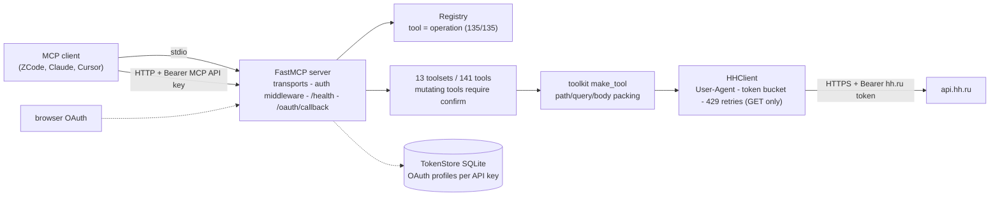

# ati-hh-mcp

[](https://github.com/timur-ai/ati-hh-mcp/actions/workflows/ci.yml)
[](https://timur-ai.github.io/ati-hh-mcp/)
[](#requirements)
[](#development)
[](LICENSE)

Public MCP (Model Context Protocol) server for the [hh.ru](https://hh.ru) API:
every operation of the public hh.ru OpenAPI specification – all 135 of them –
exposed as grouped, switchable toolsets for LLM agents. stdio for personal
use, streamable HTTP with API keys and OAuth for teams.

- **Complete and verified**: 135/135 public OpenAPI operations are implemented
  and locked by a contract metatest (operations *and* required parameters);
  responses are checked against the vendored specification with live-recorded
  fixtures.
- **Safe by design**: mutations require an explicit `confirm=true` argument;
  GET requests are throttled and retried on 429, mutations never repeat
  automatically; tokens never appear in logs.
- **Built for LLMs**: domain-prefixed snake_case tool names, concise English
  descriptions, structured errors with hh.ru codes and Russian descriptions.

[Русская версия документации](README_RU.md)

## Contents

- [Requirements](#requirements)
- [Quick start](#quick-start)
  - [uvx from git (stdio)](#uvx-from-git-stdio)
  - [Docker Compose (HTTP)](#docker-compose-http)
- [Client configuration](#client-configuration)
  - [ZCode (stdio)](#zcode-stdio)
  - [Claude Desktop (stdio)](#claude-desktop-stdio)
  - [Cursor (stdio and HTTP)](#cursor-stdio-and-http)
- [Toolsets](#toolsets)
- [Authorization](#authorization)
  - [1. Static token](#1-static-token)
  - [2. Per-request token header](#2-per-request-token-header)
  - [3. OAuth login](#3-oauth-login)
  - [Registering an hh.ru application](#registering-an-hhru-application)
- [Two-level search schema](#two-level-search-schema)
- [Architecture](#architecture)
- [Configuration](#configuration)
- [Limitations](#limitations)
- [Documented deviations](#documented-deviations)
- [Development](#development)
- [License](#license)

## Requirements

- Python 3.10 – 3.14 (CI matrix covers every minor version), or Docker.
- [uv](https://docs.astral.sh/uv/) for the uvx/stdio path.
- An hh.ru API token or a registered OAuth application for authorized calls;
  public dictionaries, suggestions and vacancy search work without a token.

## Quick start

### uvx from git (stdio)

No clone, no install – the server runs straight from the repository:

```bash
uvx --from git+https://github.com/timur-ai/ati-hh-mcp ati-hh-mcp serve --transport stdio
```

The command starts the server on stdio with the default toolsets. Point an
MCP client at it (see [client configuration](#client-configuration)) and set
`HH_TOKEN` in the server environment for authorized tools.

### Docker Compose (HTTP)

```bash
git clone https://github.com/timur-ai/ati-hh-mcp
cd ati-hh-mcp
MCP_API_KEYS="$(openssl rand -hex 32)" docker compose up --build
```

Clients connect to `http://localhost:8080/mcp` with
`Authorization: Bearer <your-api-key>`. The container is non-root, has a
`/health` endpoint for the Compose healthcheck, and keeps OAuth tokens in a
SQLite volume. See the [deployment guide](https://timur-ai.github.io/ati-hh-mcp/deployment/)
for multi-user setup.

**TLS is mandatory for network exposure**: the server speaks plain HTTP, so
put a TLS-terminating reverse proxy (Caddy/nginx) in front of it, bind the
container to `127.0.0.1` and run a single worker process – see the
[deployment guide](https://timur-ai.github.io/ati-hh-mcp/deployment/) for
ready-made proxy snippets.

## Client configuration

### ZCode (stdio)

`.zcode/settings.json` in the project (or the user config):

```json
{
  "mcpServers": {
    "hh": {
      "command": "uvx",
      "args": [
        "--from", "git+https://github.com/timur-ai/ati-hh-mcp",
        "ati-hh-mcp", "serve", "--transport", "stdio"
      ],
      "env": {
        "HH_TOKEN": "YOUR_HH_TOKEN",
        "HH_UA_EMAIL": "you@example.com"
      }
    }
  }
}
```

### Claude Desktop (stdio)

`claude_desktop_config.json`
(macOS: `~/Library/Application Support/Claude/claude_desktop_config.json`,
Windows: `%APPDATA%\Claude\claude_desktop_config.json`):

```json
{
  "mcpServers": {
    "hh": {
      "command": "uvx",
      "args": [
        "--from", "git+https://github.com/timur-ai/ati-hh-mcp",
        "ati-hh-mcp", "serve", "--transport", "stdio"
      ],
      "env": {
        "HH_TOKEN": "YOUR_HH_TOKEN",
        "HH_UA_EMAIL": "you@example.com"
      }
    }
  }
}
```

### Cursor (stdio and HTTP)

`.cursor/mcp.json`. stdio launch:

```json
{
  "mcpServers": {
    "hh": {
      "command": "uvx",
      "args": [
        "--from", "git+https://github.com/timur-ai/ati-hh-mcp",
        "ati-hh-mcp", "serve", "--transport", "stdio"
      ],
      "env": {
        "HH_TOKEN": "YOUR_HH_TOKEN",
        "HH_UA_EMAIL": "you@example.com"
      }
    }
  }
}
```

Connection to the Docker/HTTP deployment:

```json
{
  "mcpServers": {
    "hh": {
      "url": "http://localhost:8080/mcp",
      "headers": {
        "Authorization": "Bearer YOUR_MCP_API_KEY"
      }
    }
  }
}
```

## Toolsets

62 tools are enabled by default; six employer toolsets and the undocumented
extended set are opt-in via `HH_TOOLSETS`. `HH_TOOLSETS` fully replaces the
default list; the `auth` toolset is always included regardless.
A generated catalog with every tool, its OpenAPI operation and description
lives in the [tool reference](https://timur-ai.github.io/ati-hh-mcp/tools/).

| Toolset | Tools | Default | Domain |
| --- | :---: | :---: | --- |
| `auth` | 5 | always on | `/me` profile, OAuth login/exchange/status/logout |
| `dictionaries` | 16 | on | areas, industries, professional roles, languages, locales, metro, skills, universities, vacancy conditions |
| `suggests` | 11 | on | search suggestions: areas, companies, positions, skills, keywords |
| `vacancies` | 4 | on | vacancy search, similar and related vacancies |
| `negotiations` | 10 | on | responses/invitations: lists, states, messages, tests, invitations |
| `chats` | 14 | on | chats: messages, participants, files, read counters |
| `resumes` | 2 | on | resume viewing, call-tracking phone numbers |
| `employer_vacancies` | 23 | off | employer vacancy CRUD, drafts, publication, statistics |
| `employer_negotiations` | 5 | off | employer responses/invitations, mail templates, statistics |
| `employer_resumes` | 11 | off | resume search (52 parameters), saved searches, applicant comments |
| `employer_managers` | 11 | off | managers, settings, access and limits |
| `employer_misc` | 25 | off | employers info, addresses, departments, calls, webhooks, salary statistics |
| `extended` | 4 | off | **undocumented**: apply to a vacancy, own resumes, artifacts |

Enable extra toolsets with a comma-separated list, for example
`HH_TOOLSETS=employer_vacancies,employer_resumes`.

## Authorization

The server separates *access to the MCP server* from *access to hh.ru*:

- `Authorization: Bearer <key>` (HTTP mode) – the MCP API key from
  `MCP_API_KEYS`; protects the server itself in multi-user deployments.
- `X-HH-Token: <hh-token>` – the hh.ru token for a single request (HTTP mode).
- OAuth profile – token pairs stored in SQLite per MCP API key.

An hh.ru token can be provided in three ways.

### 1. Static token

Set `HH_TOKEN` in the server environment (the usual stdio path). Applies to
every call of the deployment; in HTTP mode with `MCP_API_KEYS` set, `HH_TOKEN`
is deliberately ignored to avoid mixing user profiles.

### 2. Per-request token header

Send `X-HH-Token: <token>` with an MCP call (HTTP mode). The token is used
statelessly for that request only and is never stored.

### 3. OAuth login

With `HH_CLIENT_ID`, `HH_CLIENT_SECRET` and `HH_REDIRECT_URI` configured:

- **stdio**: call `auth_get_login_url`, open the URL in a browser, log in on
  hh.ru, copy the `code` parameter from the redirect address, then call
  `auth_exchange_code(code)`. Token pairs land in the local SQLite store and
  refresh automatically.
- **HTTP**: same flow, but the redirect goes to `GET /oauth/callback` on the
  server and the exchange completes automatically. The OAuth `state` parameter
  is bound to the caller's profile, so tokens land in the right SQLite profile.

`auth_status` shows the current profile state, `auth_logout` calls
`DELETE /token` on hh.ru and drops the stored pair.

### Registering an hh.ru application

1. Sign in at [dev.hh.ru](https://dev.hh.ru) and open the application admin.
2. Create an application; you will get `HH_CLIENT_ID` and `HH_CLIENT_SECRET`.
3. Register the redirect URI:
   - HTTP deployment: `http://<your-host>:8080/oauth/callback`
     (for local testing `http://localhost:8080/oauth/callback`);
   - stdio: any previously registered URI works – you copy the code manually.
4. Set `HH_CLIENT_ID`, `HH_CLIENT_SECRET`, `HH_REDIRECT_URI` in the server
   environment and restart.

## Two-level search schema

Heavy search operations (`search_vacancies` with 45 parameters,
`employer_search_resumes` with 52) would bury an LLM in flat arguments. Such tools use
a two-level schema: frequent filters are top-level tool parameters, the long
tail lives in a nested `advanced` object:

```json
{
  "text": "python developer",
  "area": "1",
  "salary": 200000,
  "advanced": { "work_format": "remote", "date_from": "2026-01-01" }
}
```

Unset fields – top-level or nested – are simply not sent to hh.ru. The
allowed subset is locked in the tool registry and verified by the contract
metatest, so no parameter outside the OpenAPI operation can sneak in.

## Architecture



- **Transports**: stdio for personal launch (`uvx git+...`), streamable HTTP
  with `MCP_API_KEYS` for teams; `/health` for Docker healthchecks.
- **Registry**: the single source of truth mapping every tool to its OpenAPI
  operation; a contract metatest enforces `required params of the operation
  subset of tool params subset of operation params`.
- **HHClient**: token-bucket throttling (default 25 req/min), the User-Agent
  contact policy of hh.ru, automatic 429 retries for GET only – mutations
  fail loudly instead of repeating.
- **TokenStore**: SQLite, one OAuth profile per MCP API key (keyed by the
  sha256 hash – raw keys are never stored); automatic refresh on expiry.

## Configuration

| Environment variable | Default | Purpose |
| --- | --- | --- |
| `HH_TOKEN` | – | hh.ru token for all calls (stdio path; ignored in HTTP mode with `MCP_API_KEYS`) |
| `HH_CLIENT_ID` | – | OAuth application client id (dev.hh.ru) |
| `HH_CLIENT_SECRET` | – | OAuth application client secret |
| `HH_REDIRECT_URI` | – | OAuth redirect URI registered at dev.hh.ru |
| `HH_TOOLSETS` | default set | Comma-separated toolsets to enable; fully replaces the default list (`auth` is always included) |
| `HH_API_BASE` | `https://api.hh.ru` | API base URL (tests and experiments) |
| `HH_UA_EMAIL` | placeholder | Contact email in the User-Agent (hh.ru requirement) |
| `HH_RATE_LIMIT` | `25` | Requests per minute (token bucket) |
| `HH_TOKEN_STORE` | platform dir | SQLite path for OAuth token pairs (Docker: `/data/tokens.sqlite3`) |
| `MCP_API_KEYS` | – | Comma-separated API keys guarding the HTTP endpoint (case-sensitive) |

## Limitations

Stated honestly:

- **No resume CRUD.** The public hh.ru OpenAPI has no operations to create or
  edit resumes; the `resumes` toolset is read-only by design.
- **The extended toolset is undocumented API.** `apply_to_vacancy`,
  `my_resumes`, `artifacts_list`, `artifact_delete` rely on endpoints outside
  the public specification; they are disabled by default, marked
  `[UNDOCUMENTED hh.ru API]` and may break without notice.
- **Authorization header semantics.** `Authorization` carries the *MCP server*
  API key, not the hh.ru token; the hh.ru token travels in `X-HH-Token` or
  `HH_TOKEN`. This mirrors the two-tenant reality (server access vs hh.ru
  access) and is an intentional deviation from the hh.ru API convention.
- **Retries are GET-only.** A timed-out mutation is reported as an error with
  a "may have been applied" hint; it is never retried automatically.
- **The live API drifts from the specification.** Responses are validated
  against the vendored OpenAPI with live-recorded fixtures; the single
  confirmed deviation (`GET /suggests/companies` returns `null` in
  non-nullable `url`, `area.name`, `logo_urls`) is pinned in
  `KNOWN_DEVIATIONS` of `tests/contract/test_schemas.py`.
- **Search endpoints are geo-blocked** for datacenter IPs by hh.ru; the
  fixture recorder skips them (403 `forbidden`) when run from such networks.
  The server itself is unaffected when run from an allowed network.

## Documented deviations

From the original design decisions, recorded with reasons:

- **FastMCP 4.1** instead of "FastMCP 2": the plan fixed the family, the
  concrete major was chosen in the M1 spike by stability and Python 3.10–3.14
  support criteria; pinned in `uv.lock`. Details:
  [ADR Z1](docs/adr/Z1-fastmcp-major.md).
- **`__main__` coverage floor is 90 %**, below the project-wide 95 % – the
  CLI entrypoint is a thin argument parser around tested components.
- **Distribution is sources-only** (git + Docker): no PyPI, no GHCR, per the
  project decision.

## Development

```bash
uv sync --dev                # environment
uv run pytest -q             # 547 tests (+8 live, opt-in): unit + contract + MCP e2e
uv run ruff check src tests  # lint
uv run mypy src              # strict type check
```

Useful maintenance scripts:

```bash
uv run python scripts/record_fixtures.py    # re-record live response fixtures (read-only, sanitized)
uv run python scripts/gen_tool_docs.py      # regenerate docs/tools/ from the registry
bash scripts/fetch_openapi.sh               # refresh the vendored OpenAPI spec
uv run mkdocs serve                         # documentation site locally
```

Live integration tests (`tests/integration_live/`, marker `live`) are opt-in
and safe: read-only calls, token from the `HH_LIVE_TOKEN` secret, masked in
logs. The documentation site builds strictly (`mkdocs build --strict`) and
deploys to GitHub Pages from `main` on every push.

## License

[MIT](LICENSE)
