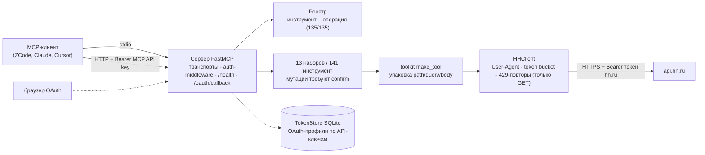

# ati-hh-mcp

[](https://github.com/timur-ai/ati-hh-mcp/actions/workflows/ci.yml)
[](https://timur-ai.github.io/ati-hh-mcp/)
[](https://timur-ai.github.io/ati-hh-mcp/)
[](LICENSE)

Публичный MCP-сервер (Model Context Protocol) для API [hh.ru](https://hh.ru):
все операции публичной OpenAPI-спецификации hh.ru – все 135 – открыты как
сгруппированные переключаемые наборы инструментов для LLM-агентов. stdio –
для личного использования, streamable HTTP с API-ключами и OAuth – для команд.

Полная английская версия – [README.md](README.md). Сайт документации –
<https://timur-ai.github.io/ati-hh-mcp/>.

- **Полнота проверяема**: реализованы 135 из 135 операций публичной OpenAPI;
  соответствие (операции *и* обязательные параметры) закреплено контрактным
  метатестом; ответы сверяются с вендорённой спецификацией по живым фикстурам.
- **Безопасность по построению**: изменяющие операции требуют явный аргумент
  `confirm=true`; GET-запросы троттлятся и повторяются при 429, мутации никогда
  не повторяются автоматически; токены не попадают в логи.
- **Сделано для LLM**: имена инструментов с доменным префиксом в snake_case,
  лаконичные английские описания, структурированные ошибки с кодами hh.ru и
  русскими описаниями.

## Содержание

- [Требования](#требования)
- [Быстрый старт](#быстрый-старт)
- [Конфигурация клиентов](#конфигурация-клиентов)
- [Наборы инструментов](#наборы-инструментов)
- [Авторизация](#авторизация)
- [Двухуровневая схема поиска](#двухуровневая-схема-поиска)
- [Архитектура](#архитектура)
- [Конфигурация (переменные окружения)](#конфигурация-переменные-окружения)
- [Ограничения](#ограничения)
- [Задокументированные отступления](#задокументированные-отступления)
- [Разработка](#разработка)
- [Лицензия](#лицензия)

## Требования

- Python 3.10–3.14 (CI-матрица покрывает каждую минорную версию) или Docker.
- [uv](https://docs.astral.sh/uv/) для запуска через uvx/stdio.
- Токен hh.ru или зарегистрированное OAuth-приложение для авторизованных
  вызовов; публичные справочники, подсказки и поиск вакансий работают без
  токена.

## Быстрый старт

### uvx из git (stdio)

Без клонирования и установки – сервер запускается прямо из репозитория:

```bash
uvx --from git+https://github.com/timur-ai/ati-hh-mcp ati-hh-mcp serve --transport stdio
```

Команда поднимает сервер на stdio с наборами по умолчанию. Подключите
MCP-клиент (см. [конфигурацию клиентов](#конфигурация-клиентов)); для
авторизованных инструментов задайте `HH_TOKEN` в окружении сервера.

### Docker Compose (HTTP)

```bash
git clone https://github.com/timur-ai/ati-hh-mcp
cd ati-hh-mcp
MCP_API_KEYS="$(openssl rand -hex 32)" docker compose up --build
```

Клиенты подключаются к `http://localhost:8080/mcp` с заголовком
`Authorization: Bearer <ваш-api-ключ>`. Контейнер работает от
непривилегированного пользователя, отдаёт `/health` для healthcheck Compose и
хранит OAuth-токены в SQLite на volume. Многопользовательская настройка – в
[руководстве по развёртыванию](https://timur-ai.github.io/ati-hh-mcp/deployment/).

**При доступе из сети TLS обязателен**: сервер говорит по чистому HTTP –
поставьте спереди TLS-прокси (Caddy/nginx), привяжите контейнер к
`127.0.0.1` и держите один worker-процесс; готовые конфигурации прокси – в
[руководстве по развёртыванию](https://timur-ai.github.io/ati-hh-mcp/deployment/).

## Конфигурация клиентов

### ZCode (stdio)

`.zcode/settings.json` в проекте (или пользовательская конфигурация):

```json
{
  "mcpServers": {
    "hh": {
      "command": "uvx",
      "args": [
        "--from", "git+https://github.com/timur-ai/ati-hh-mcp",
        "ati-hh-mcp", "serve", "--transport", "stdio"
      ],
      "env": {
        "HH_TOKEN": "ВАШ_ТОКЕН_HH",
        "HH_UA_EMAIL": "you@example.com"
      }
    }
  }
}
```

### Claude Desktop (stdio)

`claude_desktop_config.json`
(macOS: `~/Library/Application Support/Claude/claude_desktop_config.json`,
Windows: `%APPDATA%\Claude\claude_desktop_config.json`):

```json
{
  "mcpServers": {
    "hh": {
      "command": "uvx",
      "args": [
        "--from", "git+https://github.com/timur-ai/ati-hh-mcp",
        "ati-hh-mcp", "serve", "--transport", "stdio"
      ],
      "env": {
        "HH_TOKEN": "ВАШ_ТОКЕН_HH",
        "HH_UA_EMAIL": "you@example.com"
      }
    }
  }
}
```

### Cursor (stdio и HTTP)

`.cursor/mcp.json`. Запуск через stdio:

```json
{
  "mcpServers": {
    "hh": {
      "command": "uvx",
      "args": [
        "--from", "git+https://github.com/timur-ai/ati-hh-mcp",
        "ati-hh-mcp", "serve", "--transport", "stdio"
      ],
      "env": {
        "HH_TOKEN": "ВАШ_ТОКЕН_HH",
        "HH_UA_EMAIL": "you@example.com"
      }
    }
  }
}
```

Подключение к Docker/HTTP-развёртыванию:

```json
{
  "mcpServers": {
    "hh": {
      "url": "http://localhost:8080/mcp",
      "headers": {
        "Authorization": "Bearer ВАШ_MCP_API_KEY"
      }
    }
  }
}
```

## Наборы инструментов

По умолчанию включены 62 инструмента; шесть employer-наборов и
недокументированный extended включаются переменной `HH_TOOLSETS`.
`HH_TOOLSETS` полностью заменяет список по умолчанию; набор `auth`
подключается всегда, даже если не перечислен. Справочник со всеми
инструментами, их операциями OpenAPI и описаниями генерируется из реестра:
[каталог инструментов](https://timur-ai.github.io/ati-hh-mcp/tools/).

| Набор | Инструментов | По умолчанию | Предметная область |
| --- | :---: | :---: | --- |
| `auth` | 5 | всегда | профиль `/me`, OAuth-вход/обмен/статус/выход |
| `dictionaries` | 16 | вкл. | справочники: регионы, индустрии, профроли, языки, локали, метро, навыки, вузы, условия вакансий |
| `suggests` | 11 | вкл. | подсказки поиска: регионы, компании, должности, навыки, ключевые слова |
| `vacancies` | 4 | вкл. | поиск вакансий, похожие и связанные вакансии |
| `negotiations` | 10 | вкл. | отклики/приглашения: списки, статусы, сообщения, тесты, приглашения |
| `chats` | 14 | вкл. | чаты: сообщения, участники, файлы, счётчики непрочитанного |
| `resumes` | 2 | вкл. | просмотр резюме, телефон через колл-трекинг |
| `employer_vacancies` | 23 | выкл. | CRUD вакансий работодателя, черновики, публикация, статистика |
| `employer_negotiations` | 5 | выкл. | отклики/приглашения работодателя, шаблоны писем, статистика |
| `employer_resumes` | 11 | выкл. | поиск резюме (52 параметра), сохранённые поиски, комментарии |
| `employer_managers` | 11 | выкл. | менеджеры, настройки, доступы и лимиты |
| `employer_misc` | 25 | выкл. | данные работодателей, адреса, отделы, звонки, вебхуки, статистика зарплат |
| `extended` | 4 | выкл. | **недокументированные**: отклик на вакансию, свои резюме, артефакты |

Дополнительные наборы включаются списком через запятую, например
`HH_TOOLSETS=employer_vacancies,employer_resumes`.

## Авторизация

Сервер разделяет *доступ к MCP-серверу* и *доступ к hh.ru*:

- `Authorization: Bearer <ключ>` (HTTP) – API-ключ из `MCP_API_KEYS`;
  защищает сам сервер в многопользовательском развёртывании.
- `X-HH-Token: <токен>` – токен hh.ru на один запрос (HTTP).
- OAuth-профиль – пары токенов в SQLite, по профилю на каждый API-ключ.

Токен hh.ru передаётся тремя способами.

### 1. Статичный токен

Задайте `HH_TOKEN` в окружении сервера (обычный путь stdio). Токен действует
на все вызовы развёртывания; в HTTP-режиме с заданным `MCP_API_KEYS` env-токен
намеренно игнорируется, чтобы не смешивать профили пользователей.

### 2. Заголовок на запрос

Передайте `X-HH-Token: <токен>` вместе с MCP-вызовом (HTTP). Токен
используется statelessly только для этого запроса и не сохраняется.

### 3. OAuth-вход

При заданных `HH_CLIENT_ID`, `HH_CLIENT_SECRET` и `HH_REDIRECT_URI`:

- **stdio**: вызовите `auth_get_login_url`, откройте ссылку в браузере,
  войдите на hh.ru, скопируйте параметр `code` из адреса переадресации и
  передайте его в `auth_exchange_code(code)`. Пара токенов попадёт в локальную
  SQLite-базу и будет обновляться автоматически.
- **HTTP**: тот же сценарий, но переадресация ведёт на `GET /oauth/callback`
  сервера и обмен завершается автоматически. Параметр `state` привязан к
  профилю вызвавшего, поэтому токены попадают в нужный профиль SQLite.

`auth_status` показывает состояние профиля, `auth_logout` вызывает
`DELETE /token` на hh.ru и удаляет сохранённую пару.

### Регистрация приложения hh.ru

1. Войдите на [dev.hh.ru](https://dev.hh.ru) и откройте админку приложений.
2. Создайте приложение – получите `HH_CLIENT_ID` и `HH_CLIENT_SECRET`.
3. Зарегистрируйте redirect URI:
   - HTTP-развёртывание: `http://<ваш-хост>:8080/oauth/callback`
     (для локальной проверки `http://localhost:8080/oauth/callback`);
   - stdio: подойдёт любой заранее зарегистрированный URI – код копируется
     вручную.
4. Задайте `HH_CLIENT_ID`, `HH_CLIENT_SECRET`, `HH_REDIRECT_URI` в окружении
   сервера и перезапустите его.

## Двухуровневая схема поиска

Тяжёлые поисковые операции (`search_vacancies` – 45 параметров,
`employer_search_resumes` – 52) утопили бы LLM в плоских аргументах. Такие инструменты
используют двухуровневую схему: частые фильтры – параметры верхнего уровня,
длинный хвост – вложенный объект `advanced`:

```json
{
  "text": "python developer",
  "area": "1",
  "salary": 200000,
  "advanced": { "work_format": "remote", "date_from": "2026-01-01" }
}
```

Незаданные поля – на обоих уровнях – просто не отправляются в hh.ru.
Допустимое подмножество закреплено в реестре инструментов и проверяется
контрактным метатестом: параметр вне операции OpenAPI не проскочит.

## Архитектура



- **Транспорты**: stdio для личного запуска (`uvx git+...`), streamable HTTP с
  `MCP_API_KEYS` для команд; `/health` – для healthcheck Docker.
- **Реестр**: единственный источник соответствий «инструмент ↔ операция
  OpenAPI»; контрактный метатест соблюдает инвариант «обязательные параметры
  операции ⊆ параметры инструмента ⊆ параметры операции».
- **HHClient**: троттлинг token-bucket (по умолчанию 25 запросов/мин),
  контактная политика User-Agent hh.ru, автоповторы при 429 только для GET –
  мутации падают с явной ошибкой вместо повторов.
- **TokenStore**: SQLite, по одному OAuth-профилю на каждый MCP API-ключ
  (ключ профиля – sha256-хэш, сырые ключи не хранятся); авто-refresh
  при истечении.

## Конфигурация (переменные окружения)

| Переменная | По умолчанию | Назначение |
| --- | --- | --- |
| `HH_TOKEN` | – | токен hh.ru для всех вызовов (stdio; игнорируется в HTTP при заданном `MCP_API_KEYS`) |
| `HH_CLIENT_ID` | – | client id OAuth-приложения (dev.hh.ru) |
| `HH_CLIENT_SECRET` | – | client secret OAuth-приложения |
| `HH_REDIRECT_URI` | – | redirect URI, зарегистрированный на dev.hh.ru |
| `HH_TOOLSETS` | набор по умолчанию | включаемые наборы, через запятую; полностью заменяет список по умолчанию (`auth` подключается всегда) |
| `HH_API_BASE` | `https://api.hh.ru` | базовый URL API (тесты и эксперименты) |
| `HH_UA_EMAIL` | placeholder | контактный email в User-Agent (требование hh.ru) |
| `HH_RATE_LIMIT` | `25` | запросов в минуту (token bucket) |
| `HH_TOKEN_STORE` | системный каталог | путь SQLite для OAuth-токенов (Docker: `/data/tokens.sqlite3`) |
| `MCP_API_KEYS` | – | API-ключи доступа к HTTP-эндпоинту, через запятую (регистрозависимы) |

## Ограничения

Честно о границах:

- **Нет CRUD резюме.** В публичной OpenAPI hh.ru нет операций создания и
  редактирования резюме; набор `resumes` принципиально read-only.
- **Extended – недокументированный API.** `apply_to_vacancy`, `my_resumes`,
  `artifacts_list`, `artifact_delete` опираются на эндпоинты вне публичной
  спецификации; набор выключен по умолчанию, помечен
  `[UNDOCUMENTED hh.ru API]` и может сломаться без предупреждения.
- **Семантика заголовка Authorization.** `Authorization` несёт API-ключ
  *MCP-сервера*, а не токен hh.ru; токен hh.ru идёт в `X-HH-Token` или
  `HH_TOKEN`. Это отражает двухуровневую модель доступа (сервер vs hh.ru) и
  является осознанным отступлением от конвенции API hh.ru.
- **Повторы – только GET.** Мутация с истёкшим таймаутом возвращается как
  ошибка с подсказкой «операция могла примениться»; автоматически не
  повторяется.
- **Живой API местами расходится со спецификацией.** Ответы валидируются
  против вендорённой OpenAPI по живым фикстурам; единственное подтверждённое
  расхождение (`GET /suggests/companies` возвращает `null` в не-nullable
  `url`, `area.name`, `logo_urls`) зафиксировано в `KNOWN_DEVIATIONS` файла
  `tests/contract/test_schemas.py`.
- **Поисковые эндпоинты гео-блокируются** hh.ru для датацентровых IP;
  записыватель фикстур пропускает их (403 `forbidden`) из таких сетей. Сам
  сервер при запуске из разрешённой сети работает штатно.

## Задокументированные отступления

От исходных проектных решений, с причинами:

- **FastMCP 4.1** вместо «FastMCP 2»: план фиксировал семейство, конкретный
  мажор выбран в спайке M1 по критериям стабильности API и поддержки Python
  3.10–3.14; запинен в `uv.lock`. Подробности:
  [ADR Z1](https://timur-ai.github.io/ati-hh-mcp/adr/Z1-fastmcp-major/).
- **Порог покрытия `__main__` – 90 %** при проектных 95 %: CLI-точка входа –
  тонкий парсер аргументов вокруг протестированных компонентов.
- **Распространение только исходниками** (git + Docker): без PyPI и GHCR –
  решение проекта.

## Разработка

```bash
uv sync --dev                # окружение
uv run pytest -q             # 527 тестов: unit + контрактные + e2e MCP-клиента
uv run ruff check src tests  # линтер
uv run mypy src              # строгая проверка типов
```

Скрипты сопровождения:

```bash
bash scripts/fetch_openapi.sh               # обновление вендорённой OpenAPI-спеки
uv run python scripts/record_fixtures.py    # перезапись живых фикстур (read-only, с санитизацией)
uv run python scripts/gen_tool_docs.py      # перегенерация docs/tools/ из реестра
uv run mkdocs serve                         # сайт документации локально
```

Живые интеграционные тесты (`tests/integration_live/`, маркер `live`)
подключаются опционально и безопасны: только read-only вызовы, токен из
секрета `HH_LIVE_TOKEN`, маскируется в логах. Сайт документации собирается в
строгом режиме (`mkdocs build --strict`) и деплоится на GitHub Pages из ветки
`main` при каждом пуше.

## Лицензия

[MIT](LICENSE)
