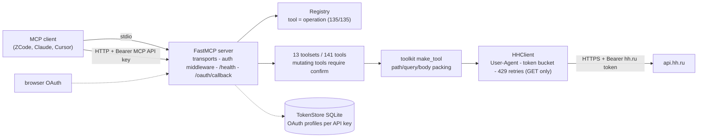

# Architecture

The server is a thin, strictly typed Python package between an MCP client and
the hh.ru API. Every layer is covered by tests: unit (mock transport),
contract (registry against the vendored OpenAPI, live fixtures against
response schemas) and e2e (a real MCP client over stdio and HTTP).

## Transports

- **stdio** – personal launch: `uvx --from git+... ati-hh-mcp serve
  --transport stdio`. stdout carries only the MCP protocol; logs go to
  stderr (verified by a test).
- **Streamable HTTP** – team deployment: `serve --transport http` (Docker
  entrypoint). Guarded by `MCP_API_KEYS` (constant-time comparison), plus
  `GET /health` for container healthchecks and `GET /oauth/callback` for the
  OAuth redirect.

## Registry and the contract metatest

`registry.py` is the single source of truth mapping every tool name to its
OpenAPI operation (`GET /vacancies`, `PUT /negotiations/{id}`, ...). The
metatest in `tests/contract/test_coverage.py` enforces, for every toolset:

- every operation of the vendored specification has a tool (or an explicit,
  reasoned exception entry);
- `required parameters of the operation` ⊆ `tool parameters` (counted
  recursively through nested pydantic models) ⊆ `parameters of the operation`;
- the service parameter `confirm` of mutations is excluded from the check.

That invariant is what makes "135/135 operations" a tested statement rather
than a marketing claim: a parameter outside the specification cannot appear,
and a required parameter cannot be forgotten.

## toolkit.make_tool

Tool mechanics are written once. `make_tool` turns a declarative description
(operation id, name, docstring, `requires_auth`, `is_mutation`, a pydantic
param model) into a flat MCP tool: parameters are expanded to the top level,
path placeholders are substituted into the URL, nested `advanced` models are
flattened into query parameters, and every mutation gains a mandatory
`confirm=true` argument. Hand-written code stays semantic only.

## HHClient

`hh/client.py` wraps httpx:

- **User-Agent policy** of hh.ru: application name/version plus the owner
  contact email from `HH_UA_EMAIL`.
- **Throttling**: a process-wide token bucket (`HH_RATE_LIMIT`, default 25
  requests per minute).
- **Retries**: automatic only for GET on 429 (up to three attempts, honoring
  `Retry-After`). Mutations never repeat – a network failure is reported as
  a structured error with a "may have been applied" hint, because the
  operation might have succeeded on the hh.ru side.
- **Errors**: HTTP statuses map to structured `HHError` values (machine code,
  Russian description, retryable flag, hint); 401 raises a dedicated
  `HHAuthExpiredError` that the OAuth layer uses for automatic refresh.

## TokenStore

SQLite storage of OAuth token pairs, one profile per MCP API key: the profile
key is the sha256 hash of the API key, so raw keys never land in the database.
Expired tokens refresh automatically; concurrent refreshes are serialized.
In stdio mode a single `default` profile is used. The store location
(`HH_TOKEN_STORE`) and every other knob are described in
[configuration](configuration.md).
